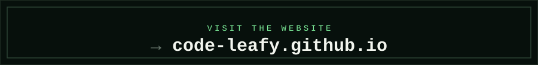

  

 

# CodeLeafy

Systems and network software developer specializing in high-throughput network tooling, desktop applications, and end-to-end Telegram bot architectures.

[Website](https://code-leafy.github.io/Code-Leafy/) • [GitHub](https://github.com/Code-Leafy) • [Telegram](https://t.me/CodeLeafy)

---

## Core Focus Areas

### Telegram Bot Architecture & Engineering
Full-lifecycle development of custom Telegram bots and Telegram Mini Apps (TMA) across any scale, complexity, or custom requirement:
- Custom interactive bots and bot ecosystems tailored to any user specification
- Telegram Mini Apps (TMA) and web-app interfaces embedded directly in Telegram
- Automated commerce, shopping cart workflows, and multi-tier administrative panels
- Payment gateway integration (cryptocurrency and fiat pipelines)
- Real-time data streams, financial feeds, and automated notification engines
- Serverless edge deployments on Cloudflare Workers and containerized backends

### Network Engineering & Proxy Tooling
- Custom implementations and tooling for VLESS, Trojan, and xHTTP protocols
- High-concurrency, asynchronous multi-threaded scanners for IP and SNI discovery
- Real-time proxy benchmarking, latency measurement, and speed-testing engines
- Linux kernel and TCP performance optimization for VPS infrastructure

### Systems & Desktop Development
- Cross-platform desktop tools built with Tauri (Rust and TypeScript)
- Native system utilities for DNS management, VPN clients, and network controls
- Single-file services and zero-dependency deployments

---

## Projects

| Repository | Description | Technologies |
| :--- | :--- | :--- |
| [**V2Leafy**](https://github.com/Code-Leafy/V2Leafy) | Unified FastAPI VLESS-over-WebSocket gateway with real-time web dashboard, traffic analytics, and client management. | Python, FastAPI, Docker |
| [**NetLeafy**](https://github.com/Code-Leafy/NetLeafy) | Client-side VLESS-over-xHTTP configuration generator optimized for edge network deployment. | JavaScript, Edge Runtime |
| [**NetLeafyScanner**](https://github.com/Code-Leafy/NetLeafyScanner) | Parallel IP/SNI discovery and proxy speed tester for VLESS and Trojan configurations. | Python, AsyncIO, Sockets |
| [**SshTunnel**](https://github.com/Code-Leafy/SshTunnel) | Automated SOCKS5 proxy panel with Docker orchestration and TCP tuning for Linux servers. | Python, Docker, Shell |

---

## Technical Stack

- **Languages:** Rust, Python, TypeScript, JavaScript, Bash, SQL
- **Frameworks & Runtimes:** Tauri, FastAPI, Cloudflare Workers, Node.js
- **Protocols & Systems:** VLESS, WebSocket, xHTTP, SOCKS5, Linux, Docker, Git

---

  CodeLeafy • <a href="https://code-leafy.github.io/Code-Leafy/">code-leafy.github.io</a>

