 

**CodeLeafy** — developer building networking tools, desktop apps, and Telegram bots.

---

## 👋 whoami

I like problems where the answer is *"just make it fast and make it work"* — so I build things that run close to the metal or right on someone else's edge:

- 🛰️ **Networking & privacy tooling** — VLESS / xHTTP config generation, tunnel management, proxy scanning and speed-testing
- 🖥️ **Desktop apps** — cross-platform Tauri (Rust + TypeScript) tools for DNS management and VPN clients
- 🤖 **Telegram bots** — small, focused automations on Cloudflare Workers: storefronts, live price feeds, chat utilities

Design taste: single-file where possible, zero-configuration where it counts, small enough to read in one sitting.

## 🌐 Everything lives on the website

My bots and their previews, the full project list with stars, and how to reach me are all on the portfolio — hit the banner below to jump over.

 

 

---

💻

