  

 

# 🌿 CodeLeafy
### Systems Developer • High-Performance Networking • Advanced Telegram Bot Architectures

 

---

## ⚡ What I Build

I design and engineer software that runs close to the metal and right at the network edge—with a strict commitment to high throughput, clean architecture, and responsive user interfaces.

### 🛰️ High-Performance Networking & Security Tooling
- **Proxy Protocols & Tunneling**: Advanced VLESS-over-WebSocket, xHTTP configuration engines, and SOCKS5 proxy architectures.
- **Traffic Diagnostics & Optimization**: High-concurrency multi-threaded IP and SNI scanners, speed benchmarks, and Linux TCP kernel tuning.
- **Creator of [V2Leafy](https://github.com/Code-Leafy/V2Leafy) (210+ ★)**: Production-grade FastAPI WebSocket gateway and real-time management dashboard.

### 🤖 Advanced Telegram Bot Engineering (Any Scale & Complexity)
- **Custom End-to-End Solutions**: Architecting complete Telegram ecosystems for any custom use-case requested—no matter how simple or complex.
- **Telegram Mini Apps (TMA)**: Full-stack interactive WebApp frontends embedded seamlessly inside Telegram chats.
- **Automated Commerce & Financial Engines**: Storefront bots with cart systems, checkout flows, crypto/fiat payment processing, live market feeds (gold, currencies, oil), and automated alerts.
- **Serverless & Edge Scalability**: Ultra-low latency deployments running serverless on Cloudflare Workers and event-driven backends with zero operational overhead.

### 🖥️ Systems & Desktop Application Development
- **Cross-Platform Desktop Apps**: Native applications built with **Tauri 2 (Rust + TypeScript)**, delivering minimal binary footprints and near-zero memory consumption.
- **GUI Utilities**: Desktop clients for DNS switching, VPN management engines, and real PTY-backed terminal experiences.

---

## ⭐ Featured Open-Source Projects

| Project | Description | Tech Stack | Stars |
| :--- | :--- | :--- | :---: |
| [**V2Leafy**](https://github.com/Code-Leafy/V2Leafy) | Unified FastAPI VLESS-over-WebSocket gateway with real-time analytics & controls | Python, FastAPI, Docker | ★ 212 |
| [**NetLeafy**](https://github.com/Code-Leafy/NetLeafy) | Client-side VLESS-over-xHTTP configuration generator for Netlify's edge | JavaScript, Edge, Web | ★ 25 |
| [**NetLeafyScanner**](https://github.com/Code-Leafy/NetLeafyScanner) | Parallel IP/SNI discovery and proxy benchmark speed tester for VLESS/Trojan | Python, AsyncIO, Sockets | ★ 13 |
| [**SshTunnel**](https://github.com/Code-Leafy/SshTunnel) | One-command automated SOCKS5 proxy panel with Docker and TCP kernel tuning | Python, Docker, Bash | ★ 3 |

---

## 🌐 Live Interactive Portfolio

Explore live bot previews, project interactive demos, and terminal showcases directly on the website:

   
  
   

---

## 📊 GitHub Analytics

  
  

 

---

### 🤝 Let's Collaborate
Have an idea for a high-performance network tool, desktop app, or custom Telegram bot?

[**Visit Portfolio**](https://code-leafy.github.io/Code-Leafy/) • [**Telegram Channel**](https://t.me/CodeLeafy) • [**GitHub Profile**](https://github.com/Code-Leafy)

Designed with precision & engineered for performance • CodeLeafy

